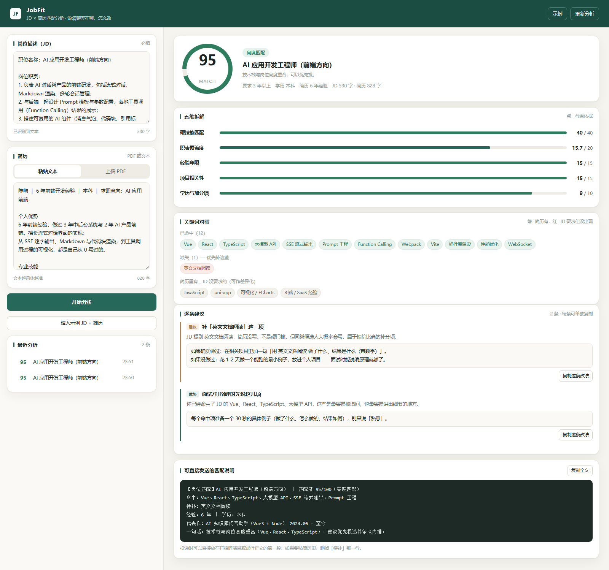

# JobFit · JD × 简历匹配分析

把一份岗位 JD 和一份简历放进去，得到一个 **0-100 的匹配分**、五个维度的扣分原因，以及**每条都能直接复制到简历里的改法**。

不做投递、不发任何东西出去——所有计算在本地服务端完成，简历不出这台机器。



---

## 这个工具解决什么问题

海投时最耗时的不是投，是判断「这份 JD 我值不值得花半小时改简历」。招聘网站的「匹配度」只会告诉你一个百分比，不会告诉你差在哪里。

JobFit 只做一件事：**把差距拆到能动手的程度**。

- 差的是硬门槛技能（比如 JD 要 Kubernetes，你完全没有）→ 面相就知道这个岗位现在够不着
- 差的是表达（你做过，但简历里没写）→ 改一句话就够
- 差的是级别（JD 要 8 年，你 7 年）→ 心里有数，谈薪时能聊

## 快速开始

```bash
npm install          # 依赖：express / cors / vue / vite
npm run build        # 构建前端到 web/dist
npm start            # 起服务，默认 http://localhost:5192
```

开发模式（前后端热更新，前端 5193、后端 5192）：

```bash
npm run dev
```

想直接看效果，不用自己准备材料：打开 <http://localhost:5192/#demo> 会自动填入一份虚构的示例 JD 和简历并跑完分析。

跑冒烟测试（服务要先起来）：

```bash
npm run smoke        # 36 项：接口、参数校验、历史记录、PDF 边界、页面可达
```

## 两种简历来源

**粘贴文本** —— 从任何地方复制简历全文（个人优势 / 技能 / 项目 / 教育经历），贴进去即可。文本越具体，分数越准。

**上传 PDF** —— 拖进去或点选，服务端本地解析成文本回填到编辑框，**可以先改错字再分析**。文件不会上传到任何第三方。

PDF 解析走两条路：

1. **Python + PyMuPDF**（主路径，本机已装，效果最好）：`python scripts/pdf-text.py <文件>`
2. **纯 Node 兜底**（没装 Python 时）：自己解 FlateDecode 流，抓文本绘制指令

两条都失败时返回 422 并提示改用粘贴文本，而不是给一个空结果。

> 想让 PDF 上传稳定可用，建议机器上装好 Python 3 与 PyMuPDF：`python -m pip install pymupdf`。
> 没装也能跑，只是复杂排版（多栏、表格）的 PDF 提取质量会下降。

## 打分规则

总分 100，五个维度相加：

| 维度 | 满分 | 怎么算的 | 为什么这么定 |
| --- | --- | --- | --- |
| 硬技能匹配 | 40 | 识别 JD 里提到的技能（46 个词条，含别名），按权重加权算简历的命中比例；加分项再给最多 3 分 | 技能是筛简历的第一道关，权重最高；单看命中率而不是命中个数，避免「JD 提了 20 项你中了 10 项」被算成高分 |
| 职责覆盖度 | 20 | JD 正文切成中文 2-gram，去掉停用字和「负责/熟悉/相关」这类泛词，看简历覆盖了多少 | 这是最容易被忽略的一维：技能全中但做过的事不一样，面试照样被挂。覆盖到 70% 才算职责高度重合 |
| 经验年限 | 15 | 解析 JD 的年限要求（`3-5 年` / `3 年以上` / 中文数字），与简历年限比较 | 差一年以内给大半分，差太多直接扣完；年限是硬门槛，虚报会在背调时翻车 |
| 项目相关性 | 15 | 取 JD 里权重最高的技术（weight 3），看它们有没有出现在你的项目描述里 | 区分「简历里列了技能」和「真的在项目里用过」——后者才是面试能讲的东西 |
| 学历与加分项 | 10 | 学历按博士/硕士/本科/大专分档；JD 的加分项命中再加分 | 学历只占 10 分：它是门槛不是竞争力，给太高的分会让真正的差距被稀释 |

等级映射：

| 分数 | 结论 | 建议动作 |
| --- | --- | --- |
| ≥ 85 | 高度匹配 | 优先投，争取内推 |
| 70-84 | 匹配度良好 | 补 1-2 处表达再投，投入产出比最高 |
| 55-69 | 可以投但需补强 | 先改简历，别用原版投 |
| < 55 | 不建议盲投 | 方向或级别不对，换岗位 |

几个校准过的坑（都在代码注释里）：

- 覆盖度阈值定在 **70%** 而不是 55%。55% 会让大部分「沾边」的简历拿满分，这个维度就白算了。
- 项目维度在 JD 没有核心技能时给 **8 分**（中性偏低），不是白给 10 分。
- 加分项最多加 **3 分**，防止靠堆加分把硬技能缺口盖住。
- 技能匹配用**小写化后 includes**，不做词边界——中文里「Vue3 开发」加边界会漏识别。

## 建议是怎么生成的

六类，按优先级排序，每条都带一段**可以直接复制的文本**：

1. 缺硬门槛技能（按权重降序，最要命的排最前）
2. 年限差距
3. 职责覆盖缺口（JD 里提到但简历没体现的工作内容）
4. 项目相关性不足
5. 学历 / 加分项
6. 优势怎么讲（永远给一条，避免只批评不给出路）

核心原则写死在 `server/advice.js` 里：**不编造经历**。每条建议都写成两条路——

> 如果确实做过，在相关项目里加一句「[用 XX 做了什么 + 结果是什么（带数字）]」。
> 如果没做过，花 1-2 天做一个能跑的最小例子，放进个人项目。

页面上还有一个「可直接发送的匹配说明」区块，是把命中的技能、待补项、经验学历和一句话结论拼成一段话，投递时能直接当打招呼消息的第一段用。

## 接口

| 方法 | 路径 | 说明 |
| --- | --- | --- |
| GET | `/api/health` | 服务状态、已存记录数、PDF 能力标记 |
| GET | `/api/sample` | 示例 JD + 虚构简历 |
| POST | `/api/resume/pdf` | `{filename, pdfBase64}` → `{text, pages, chars, via}`；400 无数据 / 413 超 12MB / 422 解析失败 |
| POST | `/api/analyze` | `{jdText, resumeText}` → `{id, createdAt, result, advice}` |
| GET | `/api/history` | 最近 20 条摘要（只含标题、分数、时间） |
| GET | `/api/history/:id` | 单条完整结果 |
| DELETE | `/api/history/:id` | 删除单条 |

分析记录只存在**内存**里，最多 20 条，且只保留 300 字预览，不长期留存整份简历。重启服务即清空——这是刻意的：简历不该无声无息地堆在磁盘上。

## 项目结构

```
jobfit/
├─ server/
│  ├─ index.js       Express 接口与静态托管
│  ├─ skills.js      技能词典（46 词条，含别名与权重）
│  ├─ parseJd.js     JD 分段：职责 / 要求 / 加分项 / 年限 / 学历 / 标题
│  ├─ parseResume.js 简历分段：优势 / 技能 / 项目 / 经历 / 教育
│  ├─ score.js       五维打分与关键词对照
│  ├─ advice.js      逐条建议 + 可复制匹配说明
│  ├─ pdfText.js     Python 主路径 + Node 兜底
│  ├─ store.js       内存记录（最近 20 条）
│  └─ samples.js     虚构示例数据
├─ scripts/
│  ├─ pdf-text.py    PyMuPDF 提取
│  ├─ smoke.mjs      36 项冒烟测试
│  ├─ _check.mjs     算法输出速查（开发用）
│  └─ _calib.mjs     五组组合校准（开发用）
└─ web/
   ├─ index.html
   └─ src/
      ├─ App.vue
      └─ components/  InputPanel / ScorePanel / KeywordPanel / AdvicePanel
```

## 已知限制

- **只有中文 JD 与中文简历**。分词是中文 2-gram，纯英文材料的效果会打折。
- **技能识别是词表匹配**，不是语义理解。JD 写「要求熟悉服务端渲染」而词表里只有 SSR，就可能漏。词表在 `server/skills.js`，加一条是一分钟的事。
- **学历只按关键词判断**（博士 > 硕士 > 本科 > 大专）。简历没写学历会按缺失处理。
- **记录在内存里**，多进程部署不共享，重启清空。
- 示例简历里的人物「陈屿」是虚构的，联系方式等字段刻意没有——避免把真实简历当示例数据发出去。

## License

MIT © 罗尉 (PetitroL)
